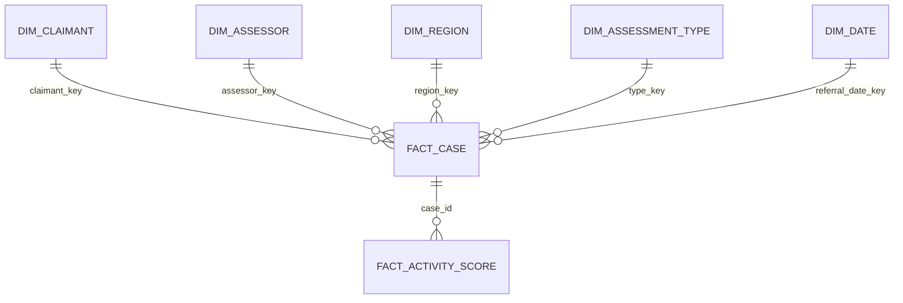

# PIP assessment quality analytics (synthetic demo)

A small, explainable Snowflake project for the candidate assignment. All names, National Insurance numbers and health categories are **fabricated**. Outputs support human quality review; they do not make decisions about claimants or assessors.

## Run order

1. `python3 scripts/generate_data.py` writes exactly three CSVs in `data/` (3,200 distinct cases). `python3 scripts/local_evidence.py` writes reproducible local smoke results to `evidence/`.
2. In a Snowflake trial account, run `sql/00_setup_and_ingest.sql` as a role allowed to create a warehouse, database, roles and resource monitor. Before its COPY statements, upload the files to `@PIP_QUALITY.RAW.INPUT_STAGE`. SnowSQL example: `PUT file:///absolute/path/to/data/*.csv @PIP_QUALITY.RAW.INPUT_STAGE AUTO_COMPRESS=FALSE OVERWRITE=TRUE;` Snowflake worksheets cannot execute `PUT`; use SnowSQL or upload the three files through Snowsight. If using the worksheet, run the DDL part of `00`, upload, then run the three COPY commands.
3. Run `sql/01_pipeline.sql` after COPY finishes. Its three Dynamic Tables initialize from RAW when created. Check `SHOW DYNAMIC TABLES IN SCHEMA PIP_QUALITY.STAGING;` to confirm `REFRESH_MODE` is `INCREMENTAL`, then run `sql/02_marts_and_analytics.sql` and `sql/03_security.sql`. Run `sql/04_quality_tests.sql` and save its Snowflake output. Grant the three roles to a real test user, map that user to a team, then run `sql/05_role_test.sql` and `sql/06_analysis_checks.sql` and save their results. The latter contains the one-off fairness, precision/recall and calibration SELECTs.
4. Create a Streamlit in Snowflake app from `app/streamlit_app.py` with `requirements.txt` dependencies, using a role that can read CORE and MART.

The SQL files are intentionally numbered and short enough to explain. `COPY INTO` loads the three CSVs into RAW; Snowpipe would add setup and running costs without helping this batch. Three incremental Dynamic Tables keep the latest case, activity and person rows after later RAW loads. `TARGET_LAG = '1 hour'` is a freshness goal, not a CSV upload schedule. The standardized, quarantined, CORE and MART views read the refreshed tables. For a live incremental demo, COPY a new case file containing an updated existing case into `RAW.CASES`, then run `ALTER DYNAMIC TABLE STAGING.CASES_LATEST REFRESH;` to show the update immediately. The MART file now has six reusable views: award and overturn rates, at-risk cases, assessor review, funnel limits, and the scorecard. The audit sample is a stored table and procedure. Fairness and model-evaluation reports are executable SELECTs in `06` because they are run for evidence rather than used by the app. To rerun from scratch, recreate the demo database. For an existing demo account with the old stream/task version, run `sql/migrate_existing_pipeline.sql` once, then rerun `01`, `02`, `03` and the checks. Review its DROP statements before use; do not run it against a production database.

## Architecture and grain

`CORE.FACT_CASE` has one row per valid case. `CORE.FACT_ACTIVITY_SCORE` has one row per case and activity. `CORE.DIM_ASSESSOR` is a simple type-2 dimension: each observed team assignment has an effective start and end; a case joins the version valid on its referral date. The generator moves assessor A001 from TEAM_A to TEAM_B in 2026. This small demo assumes no assessor returns to a previous team; a production type-2 table would use assignment event IDs and merge new versions. See [data dictionary](docs/data_dictionary.md).

## Assumptions and choices

- Daily living has ten activities and mobility two, with points `0,2,4,8,12`. This is a simplified scoring model for demonstration. Component bands are no award `<8`, standard `8–11`, enhanced `12+`. Actual PIP policy and exceptional decisions require specialist review.
- The turnaround target is **40 calendar days** from referral; an open case is at risk at day 35. Open cases have no decision date or award label. Missing assessment dates, invalid chronology and points totals that differ from the activity sum are quarantined. A recorded award that differs from the implied band stays in CORE with an exception flag for QA review.
- `audit_quality_score` is a synthetic 1–5 reviewer score. An assessor average is descriptive only.
- Mandatory reconsideration and appeal overturn rates use challenged cases as denominators. The scorecard is evaluated only on cases with a recorded challenge. It does not estimate overturn probability for all decisions without selection bias.
- The assignment's current-month sample is keyed by decision month. The seed and rationale are stored. The procedure returns without changing an existing month; only admins should have table write access. In a production system also restrict ownership and log procedure calls.
- The month has many tiny region × type × outcome × risk strata. A minimum of one per occupied stratum raises the sample fraction; reviewer capacity is about 45 files for the October demo. The sample is useful for broad QA coverage, not a precise population prevalence estimate. For 44 of 55 eligible cases, a worst-case 95% margin with finite-population correction is roughly ±6.7%; this does not cover nonresponse or measurement error.

## Evidence and current status

The checked-in [local results](evidence/local_results.json) are calculated directly from the synthetic CSVs, not from Snowflake. They show 32 duplicate case IDs, 171 quarantined cases, 3,029 curated cases, zero curated duplicate IDs/date errors/invalid labels, and a 44-case October sample. [Sample rows](evidence/local_sample_example.csv) use Python SHA-256, while the Snowflake stored procedure uses `HASH`; case IDs can therefore differ. The [local funnel dataset](evidence/local_funnel_example.csv) provides chart-ready values for 40 assessors. The [Snowflake counts](evidence/snowflake_quality_counts.csv) and [role tests](evidence/snowflake_role_test.md) were collected before the switch to Dynamic Tables; repeat them after deployment of this version.

The model's held-out local precision and recall are poor (see `evidence/local_results.json`). This is an honest result: the generator assigns challenge outcomes mostly at random, so a transparent heuristic has little signal. The model is a QA triage demonstration only. It excludes names, NI numbers, date of birth, health category, region, assessor ID and protected characteristics as predictors. Its inputs are closeness to threshold, short narrative, long turnaround, and point-band exception. The local Python split differs from Snowflake `HASH`, so re-check SQL metrics after deployment.

## Governance, retention and cost

`ASSESSMENT_ADMIN` can see identifiers; `QA_REVIEWER` sees masked identifiers but all case rows; `ASSESSOR_TEAM_VIEWER` sees only rows for teams assigned in `SECURITY.USER_TEAMS` and has no direct claimant dimension grant. Masking and row-access policies are on the exposed CORE views. RAW and STAGING are admin-only. Object tags mark direct identifiers and health data. Real grants must be assigned to actual users before the role test.

Audit query access using `SNOWFLAKE.ACCOUNT_USAGE.ACCESS_HISTORY` (allow for view latency), join `QUERY_HISTORY` for user, role and time, and review `policies_referenced` and `objects_modified`. Retention: define an approved period, expire old RAW data and staged files, and set Time Travel to the minimum permitted by policy. A subject access request can locate `claimant_id` in RAW and curated data and export authorized records. A verified deletion request must remove the claimant's rows from all three RAW sources and the persisted audit sample; the Dynamic Tables and downstream views then refresh from RAW. Purge stage files or replace them with redacted batches, and account for Time Travel/Fail-safe expiry and backups. Log approval and completion. Legal retention exceptions need a documented hold.

Use X-Small `PIP_WH`, 60-second auto-suspend, a one-hour Dynamic Table freshness target, and a 20-credit monthly resource monitor (75% notice, 100% suspend). CORE and MART views avoid separate refresh costs, though complex reads consume warehouse compute. At 100× volume, partition ingestion batches, monitor Dynamic Table refresh cost and lag, and materialize expensive marts if needed. The optional stretch goals are intentionally omitted.

## Walkthrough

[Interview notes](docs/interview_notes.md) and [10-minute speaking outline](docs/walkthrough.md). A recording requires the candidate's voice/account; the outline and runnable demo queries are provided for a live walkthrough.
